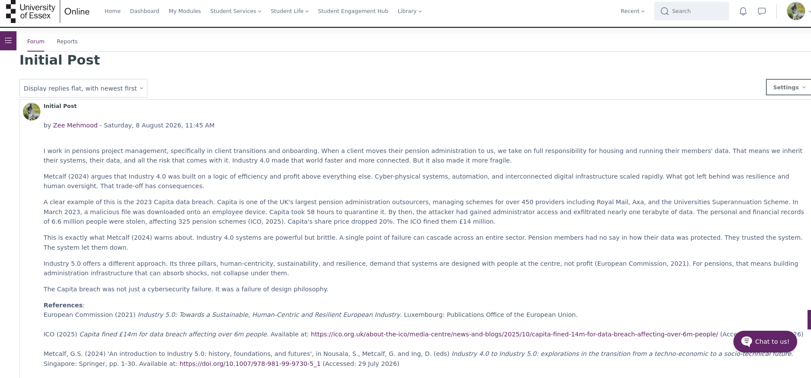
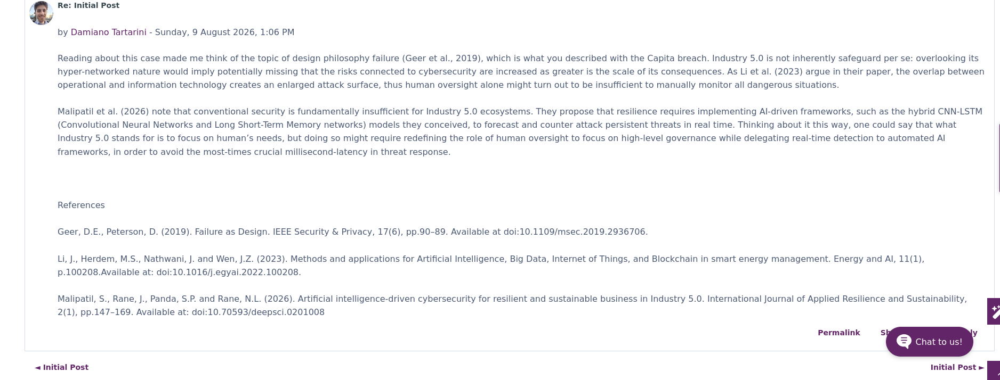
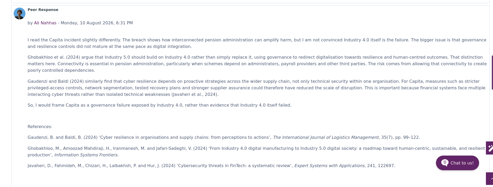
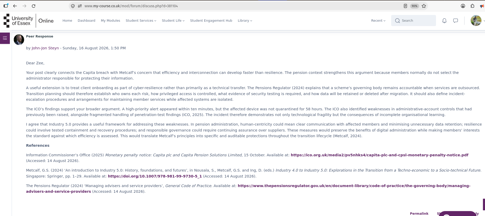
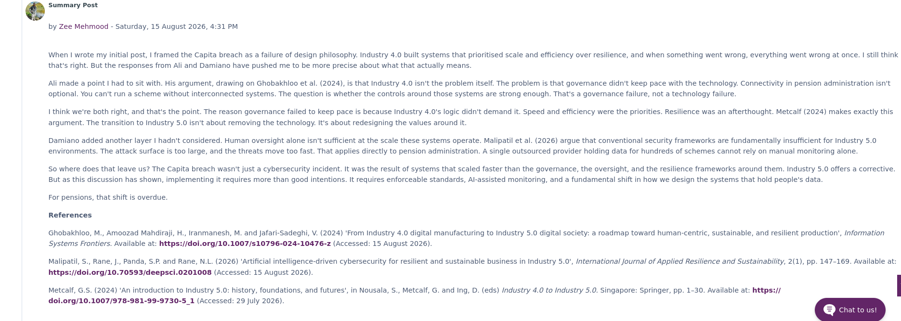

# Units 1 to 3: Collaborative Discussion 1

**Learning outcomes:** LO1, LO2, LO4

On this module, peers reply to the initial post, and I answer their points in my summary post rather than in a back-and-forth thread.

## Initial post

## Peer responses

Three peers replied to my initial post. My summary post answers the first two. The third arrived the day after my summary.

## Summary post

