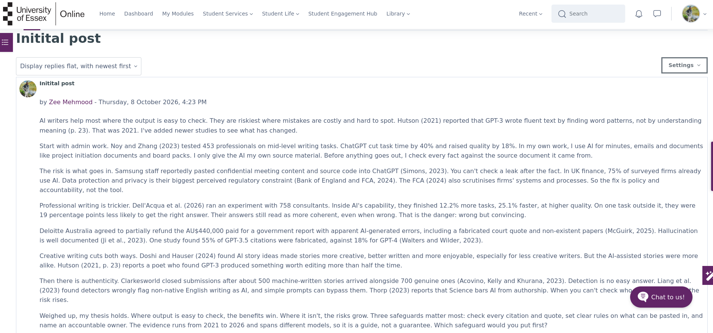
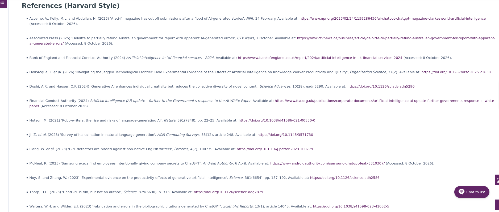
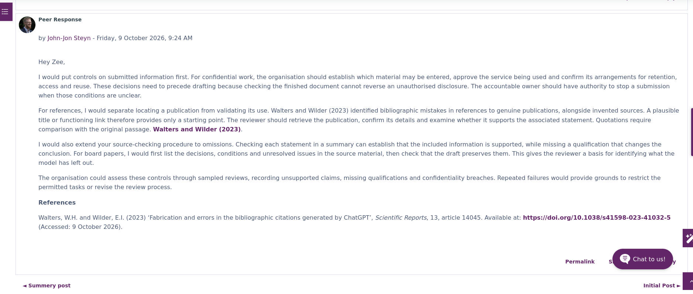
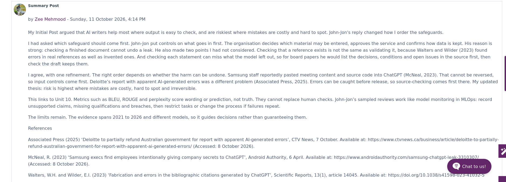

# Units 8 to 10: Collaborative Discussion 2

**Learning outcomes:** LO1, LO3, LO4

On this module, peers reply to the initial post, and I answer their points in my summary post rather than in a back-and-forth thread.

## Initial post

## Peer response

A peer's reply to my initial post. My summary post answers it.

## Summary post

